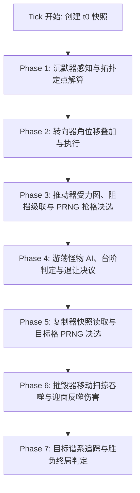

# 《构造一个我》 核心规则体系与机械构装规范指南

> 本文档旨在为游戏设计师、系统架构师及引擎开发者提供《构造一个我》 的**完整确定性技术规格说明书**。通过阅读本文档，任何人均可完整复现该游戏的所有离散时间模拟逻辑、方块交互行为、冲突决议法则，以及“枪”与“计时器/计数器”章节的所有关卡构造与机械设计。

---

## 目录
1. [离散空间与核心数据模型](#一离散空间与核心数据模型)
   - [网格坐标与方向系统](#1-网格坐标与方向系统)
   - [方块核心数据结构](#2-方块核心数据结构)
   - [刚体编组与 4-连通性规则](#3-刚体编组与-4-连通性规则)
2. [全方块类型功能规范](#二全方块类型功能规范)
   - [玩家机械方块 (Type 0 ~ 5)](#1-玩家机械方块-type-0--5)
   - [世界关卡方块 (Type 6 ~ 10)](#2-世界关卡方块-type-6--10)
3. [离散时序流水线与冲突决议规范](#三离散时序流水线与冲突决议规范)
   - [严格同时性与快照机制](#1-严格同时性与快照机制)
   - [七大微时序阶段算法流水线](#2-七大微时序阶段算法流水线)
   - [全场景冲突决议矩阵与 PRNG 仲裁](#3-全场景冲突决议矩阵与-prng-仲裁)
   - [关卡目标判定与谱系追踪](#4-关卡目标判定与谱系追踪)
4. [“枪”系列关卡深度剖析与机械构造 (Chapter 3 & 2-A)](#四枪系列关卡深度剖析与机械构造-chapter-3--2-a)
   - [枪械机械学基础原理](#1-枪械机械学基础原理)
   - [关卡 3-1：枪-1（自驱枪体 · 定向射击）](#2-关卡-3-1枪-1自驱枪体--定向射击)
   - [关卡 3-2：枪-2（连发机制 · 远距突破）](#3-关卡-3-2枪-2连发机制--远距突破)
   - [关卡 3-3：枪-3（火力矩阵 · 终极压制）](#4-关卡-3-3枪-3火力矩阵--终极压制)
   - [特殊关卡 2-A：手枪决斗（迎面碰撞 · 突破炮台）](#5-特殊关卡-2-a手枪决斗迎面碰撞--突破炮台)
5. [“计时器/计数器”系列关卡深度剖析与机械构造 (Chapter 4)](#五计时器计数器系列关卡深度剖析与机械构造-chapter-4)
   - [计时器与状态控制基础原理](#1-计时器与状态控制基础原理)
   - [关卡 4-1：计数器-1（计数雏形 · 步进触发）](#2-关卡-4-1计数器-1计数雏形--步进触发)
   - [关卡 4-2：计数器-2（状态记忆 · 周期计数）](#3-关卡-4-2计数器-2状态记忆--周期计数)
   - [关卡 4-3：计数器-3（多阶时序 · 终极逻辑）](#4-关卡-4-3计数器-3多阶时序--终极逻辑)
6. [开发者工程复现自检清单](#六开发者工程复现自检清单)

---

## 一、离散空间与核心数据模型

### 1. 网格坐标与方向系统
- **网格世界**：世界基于离散二维整数欧几里得网格 $\mathbb{Z}^2$。每个网格单元通过整数坐标 `grid_pos = Vector2i(x, y)` 唯一定位。同一时刻，每个网格单元最多容纳 **1 个** 方块实体。
- **坐标轴方向**：
  - $+X$ 轴向右（East）
  - $+Y$ 轴向下（South）
  - $-X$ 轴向左（West）
  - $-Y$ 轴向上（North）
- **方向枚举 (Direction)**：
  - `RIGHT = 0` $\rightarrow$ 向量 $(+1, 0)$
  - `DOWN  = 1` $\rightarrow$ 向量 $(0, +1)$
  - `LEFT  = 2` $\rightarrow$ 向量 $(-1, 0)$
  - `UP    = 3` $\rightarrow$ 向量 $(0, -1)$
- **方向换算公式**：
  - 前方单位向量：`fwd = DIR_VECTORS[posmod(dir, 4)]`
  - 后方单位向量：`bwd = -fwd`
  - 顺时针旋转 90°：`dir = posmod(dir + 1, 4)`
  - 逆时针旋转 90°：`dir = posmod(dir + 3, 4)`

### 2. 方块核心数据结构
每个方块实体包含以下确定的状态字段：

| 字段名称 | 类型 | 说明 |
| :--- | :--- | :--- |
| `block_id` | `int` | 全局唯一自增实体编号（用于确定性决选与持久化追踪） |
| `block_type` | `enum (0..10)` | 方块类型枚举值（详见第二节） |
| `direction` | `enum (0..3)` | 朝向（RIGHT=0, DOWN=1, LEFT=2, UP=3） |
| `grid_pos` | `Vector2i` | 当前所处网格绝对坐标 $(x, y)$ |
| `structure_id` | `int` | 刚体编组编号；`0` 表示独立游离方块，`>0` 为刚体结构成员 |
| `sub_mode` | `int` | 子模式；对于转向器（Rotator）：`0 = 顺时针 (CW)`, `1 = 逆时针 (CCW)` |
| `hp` | `int` | 当前生命值；初始值为 2，生命值归 0 时被彻底摧毁移除 |
| `max_hp` | `int` | 最大生命值，恒为 2 |
| `is_inhibited`| `bool` | 瞬态沉默标记；在每个 Tick 开始时动态计算，Tick 结束失效 |
| `is_world_block`| `bool` | 关卡预设方块标记；游玩模式下受保护不可被玩家直接擦除 |
| `origin_id` | `int` | 谱系源编号（专用于宝藏回收溯源，克隆体继承该源编号） |

- **免疫性判定 (`is_immune`)**：
  $$\text{is\_immune}(b) = (b.\text{block\_type} == \text{HARD}) \land (\neg b.\text{is\_inhibited})$$
  坚硬方块在**未被沉默**时对摧毁、位移推进、克隆读取具有天然绝对免疫；**一旦被沉默器沉默，立即彻底丧失免疫性**，可被摧毁、推动或克隆。

### 3. 刚体编组与 4-连通性规则
在《构造一个我》中，玩家可以将若干方块连接成刚体（Structure）：
1. **刚体整体运动原则**：共享同一个 `structure_id > 0` 的所有方块在受到推进力时，作为不可分割的刚体整体一同位移。
2. **强制 4-连通性约束 (Strict 4-Connectivity)**：
   - 任何合法的刚体结构，其内部所有方块必须通过曼哈顿相邻边（上下左右 4 方向）直接或间接连通。
   - **多选编组规则**：若玩家同时框选了多个不连通的孤立方块集合并按下 `G` 键，系统**严禁**将其强行赋予同一个 ID，而是执行 BFS/DFS 连通分量分解，为每个独立的连通分量分配各自独立的 `structure_id`。
   - **断裂自动解体规则**：当刚体结构内的某个桥接方块被破坏、吞噬或删除时，引擎立即对该 `structure_id` 下的所有剩余方块执行连通分量重新检测。若剩余方块被断开为 $k$ 个孤立部分（$k > 1$），则第 1 个部分保留原 ID，其余 $k-1$ 个部分自动获取新分配的唯一 `structure_id`，分裂为各自独立的刚体。
   - **切换解散规则**：如果选中的方块集合本身完全连通且已拥有相同的 `structure_id`，再次按下 `G` 键则将所有方块的 `structure_id` 归零，解散为单体游离状态。

---

## 二、全方块类型功能规范

游戏共有 11 种方块，分为**玩家机械方块**与**世界关卡方块**两大阵营：

### 1. 玩家机械方块 (Type 0 ~ 5)
玩家可在关卡建造区内自由摆放、旋转与组合的机械细胞：

#### [0] 普通方块 (Basic Block / 体细胞)
- **功能**：基础结构骨架。无主动动力，无主动攻击，用于传动连结、搭建刚体框架与承托传导。
- **生命值**：初始 HP = 2。

#### [1] 沉默器 (Inhibitor / 突触神经元)
- **朝向定义**：前方（`fwd`）为感知端（感应触须），后方（`bwd`）为沉默输出端。
- **触发机制**：在 Tick 开始的判定阶段，若其**前方紧邻网格**存在任意实体方块，且该沉默器自身未被其他沉默器沉默，则激活沉默电位。
- **执行效果**：使其**后方紧邻网格**的方块进入 `is_inhibited = true` 状态，持续整整 1 个 Tick。
- **失效后果**：被沉默的方块在本回合（当前周期）内行动等效于普通方块——主动功能不再生效（如推动器不发力、复制器不吐块、转向器不旋转、摧毁器不吞噬），被动免疫同时失效（坚硬方块可被破甲）。

#### [2] 推动器 (Pusher / 飞虫推进器)
- **朝向定义**：前方（`fwd`）为推移输出方向。
- **功能**：向自身所在刚体实体（Entity）以及紧邻其前方（`fwd`）的接触实体施加沿 `fwd` 方向的 1 单位推进冲量。
- **结构联动**：若推动器属于某个结构，它将驱动整个结构前进。若前方顶着其他独立实体，则推动该实体前进。

#### [3] 复制器 (Replicator / 有丝分裂器)
- **朝向定义**：后方（`bwd`）为样本读取端，前方（`fwd`）为克隆吐出端。
- **功能**：
  - 从 $t_0$ 时刻快照中读取其后方紧邻的一格方块作为模板；
  - 若后方有方块，且其前方一格在当前网格中**完全为空**，则在前方生成 1 块模板的完整克隆体；
  - 克隆体继承原模板的 `block_type`、`direction`、`sub_mode`、`origin_id`，生命值恢复为最大生命值（HP = 2）；
  - **重要约束**：复制生成出的新方块**绝不继承原方块的结构属性**（恒设定为游离态 `structure_id = 0`）；受保护方块（PROTECTED）与未被沉默的坚硬方块（HARD）严禁被克隆。

#### [4] 摧毁器 (Destroyer / 溶酶噬菌体)
- **朝向定义**：前方（`fwd`）为吞噬巨口方向。
- **功能**：摧毁其前方紧邻格内的目标非免疫方块，直接将其从网格中彻底抹除。
- **动态扫掠机制**：如果摧毁器在同一 Tick 内被推动器向前推移了 1 格，它既会摧毁 $t_0$ 时刻它前方面对的物体，也会摧毁到达新位置后其前方正对的物体，确保运动推移路径上的绝对清障能力。

#### [5] 转向器 (Rotator / 纤毛旋转盘)
- **模式定义**：拥有顺时针（`sub_mode = 0, CW`）和逆时针（`sub_mode = 1, CCW`）两种状态（编辑器中按 `F` 键切换）。
- **功能**：将其指向的前方紧邻格内的方块旋转 90°。
  - 顺时针模式：目标方块 `direction = (direction + 1) % 4`
  - 逆时针模式：目标方块 `direction = (direction + 3) % 4`
- **角位移代数叠加**：若多个转向器在同一 Tick 指向同一个目标方块，其旋转角度直接代数叠加后统一取模执行。

---

### 2. 世界关卡方块 (Type 6 ~ 10)
预设在关卡网格中的地形、生态生物与战略目标：

#### [6] 坚硬方块 (Hard Block / 几丁质重甲)
- **常规属性**：天然绝对免疫摧毁、位移与克隆读取。任何推力碰到坚硬方块均被完全阻挡。
- **破甲机制**：**若被沉默器沉默，则其 `is_immune` 判定转为 `false`！** 此时坚硬方块在本回合内行动等效于普通方块，可以被摧毁器吞噬，也可以被推进器推走，或被复制器克隆。

#### [7] 游荡怪物 (Wanderer / 异化游荡体)
- **自主 AI 巡逻特性**：
  1. 仅沿水平方向巡航（朝向归一化为 LEFT 或 RIGHT）。
  2. **平台巡逻与 1 格台阶下落**：
     - 若正前方下落 1 格存在地面：平地踏步前移。
     - 若正前方下落 1 格为空，但下落 2 格有地面：顺畅走下 1 格台阶。
     - 若高差 $> 1$ 格（下落 1 格与 2 格皆为空无地面）：**怪物绝不会跳下高悬崖**，而是立即原地掉头巡逻！
  3. **障碍物接触伤害与单格攀爬**：
     - 遇到前方有阻挡方块时，立即对前方障碍物造成 1 点接触伤害（HP 减 1）；
     - 若头顶与前方斜上方为空，怪物会向上跳跃翻过 1 格高的障碍台阶；若无法翻越，则调头返回。
- **退让与相撞规则**：怪物遇推移实体必定退让；双怪抢格随机退让；与迎面推进的摧毁器相撞会导致怪物死亡且摧毁器受到 1 点反噬伤害。

#### [8] 宝藏 (Treasure / 高能营养核)
- **通关回收目标**：需由玩家机械通过推移、抓取或复制运输，将其送达玩家建造区域内。
- **回收驻留法则**：进入建造区即被标记为已回收；宝藏实体保留在场上不自动销毁，以防破坏物理构装的质心平衡与连续机械运作。

#### [9] 污染源 (Pollution / 坏疽病原体)
- **通关清除目标**：关卡的核心病灶，必须将其全部彻底摧毁（场上存活数必须严格降为 0）。

#### [10] 受保护方块 (Protected Block / 晶胚核心)
- **保护守则**：关卡核心约束方块。全关卡运行全程中，**严禁摧毁任何一块受保护方块**。
- **不可克隆**：复制器无法以受保护方块为样本生成副本。
- **失败判定**：只要有任意一块受保护方块被摧毁器吃掉或被怪物撞碎，关卡立即判定失败。

---

## 三、离散时序流水线与冲突决议规范

### 1. 严格同时性与快照机制
为了消除代码中遍历顺序（Iteration Order）对游戏模拟结果的任何非确定性影响，每个离散周期（Tick）在执行任何操作之前，必须首先对当前世界状态生成深拷贝快照：
$$\text{WorldSnapshot} = \text{Clone}(\text{World at } t_0)$$
所有感知（沉默器前方判定、复制器模板采样、实体受力分析）一律基于该快照进行并行决议。

### 2. 七大微时序阶段算法流水线
单个 Tick 严格依照下列 7 个微阶段顺次执行：



#### Phase 1: 沉默器瞬态沉默结算 (Inhibitor Phase)
1. 清除全场所有方块上一轮的 `is_inhibited`。
2. 遍历快照中的所有沉默器。若沉默器前方 `grid_pos + fwd` 存在方块，且后方 `grid_pos + bwd` 存在目标方块 $T$，建立有向沉默边：$\text{Inhibitor} \to T$。
3. **拓扑定点解算 (Fixed-point Iteration)**：
   - 若某方块受到至少一个已确认为“活跃”的沉默器作用，该方块被确立为 `INHIBITED`，并失去向后发散沉默的能力（转为 `INACTIVE`）。
   - 若作用于某方块的所有潜在沉默器均被证实失效，该方块被确立为 `ACTIVE`（若其自身为沉默器且满足前向条件，则输出有效沉默）。
4. **环路死锁后备机制 (Cycle Deadlock Fallback)**：
   - 若遇到无法解析的有向环（例如两个沉默器背对背互怼形成偶数互锁环），未定节点全部触发死锁，环内所有沉默器同时进入沉默状态。

#### Phase 2: 转向器角位移结算 (Rotator Phase)
1. 遍历快照中所有未被沉默的转向器。
2. 获取前方目标方块，累计目标方块的角位移增量：
   $$\Delta \theta(T) = \sum_{R \to T} (\text{if } R.\text{sub\_mode} == 0 \text{ then } +1 \text{ else } -1)$$
3. 对每个被指向的目标方块，统一更新其朝向：
   $$T.\text{direction} = (T.\text{direction} + \Delta \theta(T)) \bmod 4$$

#### Phase 3: 推动器受力与位移结算 (Pusher Movement Phase)
这是整个物理模拟中最精密的阶段，包含 4 步严格决议：
1. **聚合受力实体 (Entity Aggregation)**：
   - 将所有连通结构（`structure_id > 0`）与游离方块聚合成不可分割的受力实体集合 $\{E_i\}$。
2. **冲量累加与向量合成**：
   - 每个未被沉默的推动器为其所属实体施加沿其朝向的推力；若其前方紧邻另一实体且该实体不含坚硬方块，也为前方实体施加推力。
   - 对实体 $E$ 在 $X$ 轴与 $Y$ 轴分别计算净合力：
     - 若正向受力且无反向对峙：$\Delta x = +1$；若反向受力且无正向对峙：$\Delta x = -1$；若两向对峙：$\Delta x = 0$。
     - 同理合成 $\Delta y$。
     - **双向推力仲裁**：若实体同时在 $X$ 轴与 $Y$ 轴受到有效合力（$\Delta x \neq 0 \land \Delta y \neq 0$），系统**严禁**该物体同时沿两个方向对角斜向移动，而是通过确定性 PRNG 均匀随机选择其中一个方向先行移动，另一个方向在本回合中彻底失效（置零）。
   - **坚硬方块不可推动原则**：包含任何坚硬方块的实体位移向量恒定为 $\vec{d} = (0, 0)$，严禁被推动。
3. **阻挡与级联推移检测 (Cascading Blockage)**：
   - 迭代检测：若实体 $E$ 意图移动至新位置，但目标位置被坚硬方块阻挡、或被静止实体阻挡、或被位移向量不一致的其他实体阻挡，则实体 $E$ 无法移动，其位移向量被强制置零：$\vec{d}_E = (0, 0)$。
   - 此阻挡判定会循环级联触发，直至全场所有实体的位移状态彻底收敛稳定。
4. **目标格抢格冲突与伪随机决选 (PRNG Competition)**：
   - 若存在多个独立运动实体竞争移动到同一个目标坐标格 $(x, y)$：
   - 引擎按确定性坐标排序收集所有冲突格，并对竞争候选实体按最小 `block_id` 排序，确保可复现性；
   - 随后调用伪随机数发生器 `rng.randi_range(0, N-1)` **公平随机决选出 1 个获胜实体进入目标格**；
   - 其余失败实体的位移向量全部被强制置零，终止移动保持原地；随后再次触发级联阻挡检测直至稳态。
5. **批量执行原子位移**：
   - 采用暂存格点移出再写入（Batch Move）机制，避免实体互换位置或滑动时发生字典覆写。

#### Phase 4: 游荡怪物行动 (Wanderer AI Phase)
1. 水平探路：检查面向的前方格 `fwd_pos`。
2. 下方地面检测：
   - `ground_1 = fwd_pos + (0, 1)`（平地地面）
   - `ground_2 = fwd_pos + (0, 2)`（1 格台阶地面）
3. 行为决议树：
   - 前方为空且 `ground_1` 有方块 $\rightarrow$ 平步前移 1 格。
   - 前方为空、`ground_1` 为空但 `ground_2` 有方块 $\rightarrow$ 走下 1 格台阶至 `ground_1`。
   - 前方为空且 `ground_1` 和 `ground_2` 皆为空 $\rightarrow$ 高悬崖拒跳，原地掉头！
   - 前方有方块阻挡 $\rightarrow$ 对障碍物造成 1 点咬合伤害（HP 减 1）；若头顶与斜前方为空则跳上台阶，否则掉头。
4. **怪物冲突决议原则**：
   - **绝不抢推力**：当推移实体目的地与怪物行进目的地重叠时，**怪物必须退让（保持不动）**。
   - **双怪互撞**：两只怪物竞争同一空格时，由 PRNG 随机决选一只移动，另一只退让。

#### Phase 5: 复制器复制结算 (Replicator Phase)
1. 遍历快照中的所有未被沉默的复制器。
2. 读取复制器 $t_0$ 时刻后方紧邻格的方块作为源模板 $S$。
   - 若 $S$ 为坚硬方块且未被沉默，跳过复制。
   - 若 $S$ 为受保护方块（PROTECTED），跳过复制。
3. 确定当前世界中复制器前方紧邻格的目标位置 `dest_pos`。目标格在当前世界必须为**完全未被占用的空格**。
4. **多复制器目标竞争决选**：
   - 若多个复制器同时尝试向同一空格注入副本，由 PRNG 随机抽选 1 个源模板成功写入，其余写入请求丢弃。
5. 生成副本：副本具有全新 `block_id`，继承模板朝向与源谱系 ID，但 `structure_id` 恒置为 0。

#### Phase 6: 摧毁器吞噬与碰撞结算 (Destroyer Phase)
1. 遍历摧毁器，检查其 $t_0$ 前方正对目标以及移动后新位置正对目标，标记待摧毁集合。
2. **迎面冲突反噬伤害判定 (Head-on Clash)**：
   - 若摧毁器与面向它的游荡怪物发生迎面相遇（相距 1 格或 2 格相对运动），摧毁器对怪物造成致命撕裂摧毁，但怪物也对摧毁器造成 1 点反噬咬合伤害（摧毁器 HP 减 1）。
   - 摧毁器初始 HP = 2，若此前已受过 1 点伤害，则在此次反噬中玉石俱焚被一并摧毁。
3. 批量移除所有被吞噬的方块实体。若移除的方块属于受保护方块（PROTECTED），记录破坏计数器 `destroyed_protected_count += 1`。

#### Phase 7: 目标检查与终局判定 (Goal & Victory Phase)
在当前 Tick 结束时进行绝对逻辑判定：
- **宝藏回收判定**：
  - 检查场上所有宝藏方块。若其坐标位于关卡 `player_build_area`（建造区）矩形范围内，标记该宝藏所属的 `origin_id` 谱系已成功回收。
- **严格胜利条件（必须同时满足以下所有布尔项）**：
  1. $\text{initial\_goals} > 0$（关卡必须至少包含污染、宝藏或受保护核心之一）。
  2. $\text{destroyed\_protected\_count} == 0$（严禁损毁任何受保护核心）。
  3. $\text{remaining\_pollution\_count} == 0$（场上所有污染核心必须彻底归零）。
  4. $\text{collected\_treasure\_lineages} == \text{total\_initial\_treasure\_lineages}$（初始存在的每个独立宝藏谱系，至少有 1 个副本成功送抵建造区）。

---

### 3. 全场景冲突决议矩阵与 PRNG 仲裁

| 冲突场景 | 涉及实体 | 决议结果 | 仲裁机制 | 典型设计应用 |
| :--- | :--- | :--- | :--- | :--- |
| **同向并列推移** | 多个推动器作用于同一刚体/同一物体 | 推力协同合并，正常前进 1 格 | 向量相加 | 重型装甲列车平稳驱动 |
| **反向正面对峙** | 两个推进器面对面相撞推进 | 推力在轴线上完全抵消，双方停滞原地 | 净力为 0 | 机械制动闸、互锁自锁机构 |
| **双向推力作用 (正交冲突)** | 两个方向的推进器同时作用于同一物体（如向右与向下推） | **随机一个方向先行移动，另一个方向本回合无效** | **确定性 PRNG 均匀随机 (50/50)** | 二维多路分流、随机步进触发器 |
| **多实体竞争空格** | 两个或多个推移方块试图进入同一坐标 | **1 个实体胜出进入，其余全部停在原地** | **确定性 PRNG 均匀随机** | 随机数发生器、轮盘选择器 |
| **怪物与机械抢格** | 巡逻怪物与推进器推移的方块进入同格 | **怪物退让保持原地不动，机械方块优先进入** | 规则优先级：机械 > 怪物 | 安全推铲、怪物推挤捕获阱 |
| **双怪争夺单格** | 两只游荡怪物巡逻试图踏入同一格 | **随机一方胜出进入，另一方原地等待** | **PRNG 均匀随机** | 生态种群随机游走 |
| **摧毁器撞坚硬重甲** | 未沉默的摧毁器接触坚硬方块 | 摧毁器无法吞噬，坚硬方块完好，推力被阻挡 | 免疫性保护 | 永久防爆护盾 |
| **摧毁器撞怪物正面** | 摧毁器与怪物迎面相遇 | **怪物被吞噬摧毁；摧毁器扣减 1 点 HP** | 迎面相遇撕裂与反噬 | 需用多发弹丸或多层摧毁器突破 |
| **多复制器单格写入** | 多个复制器同时朝向同一个未占用空格 | **随机写入 1 个源模板副本，其余请求抛弃** | **PRNG 均匀随机** | 细胞分裂多路选择器 |
| **沉默器偶数回路** | 两个沉默器相互背对背互指感知 | **触发死锁后备机制，双方同时被沉默** | 环路死锁保护 | 沉默振荡器、双稳态触发器 |

---

## 四、“枪”系列关卡深度剖析与机械构造 (Chapter 3 & 2-A)

> **设计思想核心著名**（仅供设计与通关思路参考）：
> “枪”的核心本质是：**在离散有限的建造区内，制造具有自主向前推进能力的动量弹丸，或建立周期性自生产的连续射击流水线，将破坏力跨越深渊和敌方防线远程精准投送。**

---

### 1. 枪械机械学基础原理
1. **单发自驱弹丸（鱼雷/自驱弹）**：
   - 最简单的发射体：由 1 个向前推进的推进器和 1 个向前的摧毁器**编为一个结构（Structure）**。
   - 发射后，推进器每一周期自主驱动该结构向目标方向飞行 1 格，前锋摧毁器清除沿途一切可破坏阻碍。
2. **闭环弹药复制装填机构**：
   - 复制器朝向目标发射轴，后方放置弹丸种子模板；
   - 利用周期时钟脉冲触发复制器，每周期向前方管腔内压入一枚全新的自驱弹丸。
3. **时钟振荡源 (Clock Oscillator)**：
   - 利用 2 到 4 个推进器在小范围导轨内循环环行，形成固定的周期脉冲（如 2 拍、3 拍或 4 拍振荡器），定时唤醒发射管。

---

### 2. 关卡 3-1：枪-1（自驱枪体 · 定向射击）

#### 关卡档案
- **关卡标识**：`custom_level_80400`
- **关卡名称**：`3-1：枪-1`
- **玩家建造区**：$x \in [-5, -1], y \in [-5, -1]$（尺寸 $5 \times 5$）
- **核心任务**：清除位于掩体深处的 1 处污染源。

#### 关卡初始战场完整构造
```text
Y坐标 | 战场实体布局 (X 从 13 到 28)
 -4   | .   .   .   .   .   .   .   .   .   .   .   .   .  Ba   .   .
 -3   | .   .   .   .   .   .   .   .   .   .   .   .  Ba   .  Ba   .
 -2   | .   .   .   .   .   .   .   .   .   .   .  Ba   .   .   .  Ba
 -1   | .  Wn<  .   .   .  Wn<  .   .   .  Wn<  .   .  Ba  Po  Ba   .
  0   | Ba  Ba  Ba   .  Ba  Ba  Ba   .  Ba  Ba  Ba   .  ##  ##  ##   .
```
- **构造剖析**：
  - 在 $X \in [13, 15], [17, 19], [21, 23]$ 分布着三座悬空平台，每座平台上各有一只游荡怪物（`Wn<`）以 3 格为周期来回巡逻。
  - 在 $X \in [24, 28]$ 处坐落着一座用普通方块拱卫的半球形穹顶掩体，底部基座为坚硬重甲（`##`），核心病灶污染源（`Po`）位于 $(26, -1)$。
  - 玩家建造区远在西侧 $X \in [-5, -1]$。

#### 核心设计思想剖析（参考）
- **致命陷阱**：摧毁器初始 HP = 2。如果玩家直接在地面层（$Y = -1$）发射一枚直线自驱导弹，该导弹在遭遇第一只和第二只怪物时发生迎面相遇碰撞，各扣 1 点 HP；行进至第二只怪与第三只怪之间时摧毁器直接解体炸毁，永远无法抵达目标！
- **战术破局**：
  - **解法一：高空巡航弹（高度跳过）**：怪物受限于重力无法跳过高空。若在 $Y = -2$ 或 $Y = -3$ 的高空构建自驱弹丸，弹丸将完全无视下方的怪物巡逻网，直接飞抵穹顶上方，咬碎普通方块护甲后直捣黄龙。
  - **解法二：重型连发纵深压制**：构建多发连射炮，第 1 发弹丸牺牲撞死先头怪，后续弹丸长驱直入。

#### 推荐通关构装配置（高空自驱巡航弹）
在建造区内搭建一枚航行于 $Y = -3$ 的编组飞弹：

```text
建造区局部图 (X=-3 到 -1, Y=-4 到 -3):
       X:  -3       -2       -1
 Y=-3:   [Pu >]   [Ba  ]   [De >]   <-- 全部选中按 G 编组为 Structure
 Y=-4:   [Pu v]   [Pu >]     .      <-- 辅助启动推块
```
- **构装方块表**：
  1. `Destroyer`：坐标 $(-1, -3)$，朝向 `RIGHT`，HP = 2
  2. `Basic`：坐标 $(-2, -3)$，朝向 `RIGHT`
  3. `Pusher`：坐标 $(-3, -3)$，朝向 `RIGHT`
- **运行结果**：启动后整枚飞弹保持在 $Y = -3$ 轨道高速飞越西面虚空，横穿 3 只怪物头顶，在第 27 拍精准咬开穹顶掩体上方弱点，彻底消灭污染核心。

---

### 3. 关卡 3-2：枪-2（连发机制 · 远距突破）

#### 关卡档案
- **关卡标识**：`custom_level_81906`
- **关卡名称**：`3-2：枪-2`
- **玩家建造区**：$x \in [-14, -1], y \in [-8, 5]$（尺寸 $14 \times 14$）
- **核心任务**：突破敌方全自动双联装炮火压制，清除深处掩体内的 3 处污染源。

#### 关卡初始战场完整构造
```text
Y坐标 | 战场实体布局 (X 从 19 到 37)
 -8   | .   .   .   .  ##  ##  ##  ##  ##  ##  ##  ##  ##  ##  ##   .   .   .   .
 -7   | .   .   .  ##   .   .  Ba  Ba   .   .   .   .  Ba  Ba   .  ##   .   .   .
 -6   | .   .  ##  ##   .  Ba   .   .  Ba   .   .  Ba   .   .  Ba  ##  ##   .   .
 -5   | .  ##  Ba  ##   .  ##   .  Wn> ##   .   .  ##   .  Wn> ##  ##   .  ##   .
 -4   | ##  Ba  Ba  ##   .  Ba  In^ Ba   .   .   .  Ba  In^ Ba   .  ##   .   .  ##
 -3   | ##  Ba  Ba  ##  De<  .  In^  .   .   .  De<  .  In^  .   .  ##   .   .  ##
 -2   | ##  Ba  Ba  ##  Rev In> In> Ba   .   .  Rev In> In> Ba   .  ##   .   .  ##
 -1   | .   .   .   .   .   .   .   .   .   .   .   .   .   .   .   .  Po  Po  Po
  0   | ##  Ba  Ba  ##   .   .   .   .   .   .   .   .   .   .   .  ##   .   .  ##
```
- **内置机械解析**：
  - 敌方阵地在 $X=23$ 与 $X=29$ 装备了两门自动加农炮：
    - 在 $(23, -2)$ 处部署着朝下的复制器（`Rev`），其后方 $(23, -3)$ 为摧毁器模板（`De<`）；
    - 复制器每隔固定周期向下方弹道吐出摧毁器弹丸，由下方阵列推向左侧；
    - 3 处污染源（`Po`）位于最深处通道 $(35, -1), (36, -1), (37, -1)$，且被敌方持续生成的迎面火力封锁。

#### 核心设计思想剖析（参考）
- 单枚导弹与敌方喷吐的摧毁器在弹道上迎面碰撞时，会因相互撕裂而耗尽耐久同归于尽。
- 玩家必须在己方宽敞的建造区内，建立**工业级持续发射机（连续供弹枪体）**，以高频连发火力冲破敌方弹道，或构建高空/低空双路交叉打击弹道，绕过敌方炮口核心。

#### 完整连发发射器构装蓝图
在建造区内部署一套典型的“节拍推进装填枪”：
- **脉冲发生器**：采用 2 个对向移动推进器构建垂直振荡发生器；
- **弹丸生成核心**：
  - 模板区：放置 `Pusher(RIGHT)` 与 `Destroyer(RIGHT)` 编组；
  - 供弹复制器：垂直对准模板，每振荡周期生成一对新方块；
  - 推出导轨：侧向推进器将刚落下的弹丸推入主发射滑轨，弹丸沿发射滑轨自主高速飞向东侧。

---

### 4. 关卡 3-3：枪-3（火力矩阵 · 终极压制）

#### 关卡档案
- **关卡标识**：`custom_level_33459`
- **关卡名称**：`3-3：枪-3`
- **玩家建造区**：$x \in [-3, 5], y \in [-6, 4]$（尺寸 $9 \times 11$）
- **核心任务**：清除防线内部极其致命的污染源。

#### 关卡预设内置“4 拍自循环振荡环火炮”结构全揭秘
关卡内置了一套完整的生物机械计算机时钟发生器与连续重炮，其结构如下：

```text
Y坐标 | 内置火炮精密结构 (X 从 18 到 25)
 -2   | [Re ^]  [In >]  [Ba   ]    .    [Ro v]  [Ba   ]  [In <]  [Re ^]
 -1   | [De <]  [In v]  [Ro >]  [Pu <]    .     [Ba   ]  [In v]  [Pu <]
  0   |   .     [In v]  [In >]    .       .     [In <]  [In v]    .  
  1   |   .     [Ba   ]    .      .     [Pu >]  [Ro <]  [Ba   ]    .  
  2   |   .       .        .    [Ro ^]    .       .       .       .  
```
- **自激振荡机制**：
  - 推动器位于 $(21, -1)$ 朝左，$(22, 1)$ 朝右；转向器环伺在四周。
  - 推进器在 $2 \times 2$ 的小网格内沿逆时针方向持续巡回：
    $$\text{Tick 1: }(21, -1) \to (21, 0) \to (21, 1) \to (22, 1) \to (22, 0) \to (22, -1) \to \text{Loop}$$
  - 每当推进器经过 $(21, 0)$ 与 $(22, -1)$ 时，触发侧翼沉默突触放电，解除复制器沉默；
  - 复制器立即将后方预设的摧毁器与推进器复制并推入发射导管，每 3 拍在 $Y = -3$ 轨道稳定射出一枚向左疾驰的自驱高速弹丸！

#### 核心设计思想剖析（参考）
- 敌方阵地发射出的弹丸密度极高。玩家若想在正面硬抗，需制造同等射频甚至更高射频的对冲装甲。
- 另一巧妙构思为“偏转拦截弹”：发射倾斜带转向器或斜向推力钩爪的机械体，在接触点将敌方射出的弹丸折射偏转入废弃深渊，从而破开突防窗口。

---

### 5. 特殊关卡 2-A：手枪决斗（迎面碰撞 · 突破炮台）

#### 关卡档案
- **关卡标识**：`custom_level_86910`
- **关卡描述**：“击败这把枪”
- **敌方手枪构装架构**：
  - 敌方位于西侧构建了一柄巨大的外形如手枪的岩石炮台。
  - 炮管内部采用双重转向器互逆调节，并通过推进器在狭长滑道内往复冲刺，形成周期性推进触发脉冲，向东侧玩家阵地持续发射高速弹丸。
- **对决思路**：
  - 玩家建造区极宽（$24 \times 18$），允许从容搭建高精度反重力炮；
  - 使用双层并列推进器制造 2 格宽度的复合重型撞击锤，由于多推力合力大于单推力，可在正面推进对峙中强势压制敌方单薄弹道，一举逆推打入敌方枪膛深处粉碎核心。

---

## 五、“计时器/计数器”系列关卡深度剖析与机械构造 (Chapter 4)

> **设计思想核心著名**（仅供设计与通关思路参考）：
> “计时器/计数器”的核心本质是：**利用空间的离散移动换取时间的精准延迟，或利用周期性步进机制记录状态阶数。在严禁伤及大面积受保护核心的前提下，唯有建立精确到‘第 N 拍’才允许动作一次的门控逻辑，才能实现手术刀式的精准打击。**

---

### 1. 计时器与状态控制基础原理
1. **移动纸带计时器 (Tape Delay Line)**：
   - 随时间以 1 格/Tick 恒速平移的长刚体条带本身就是天然的“时间刻度尺”。目标方块在纸带上的相对偏移量 $D$，严格对应绝对时间延迟 $T = D$ 拍。
2. **机械棘轮与步进齿条 (Ratchet & Escapement)**：
   - 在移动构件侧面伸出等距的拨齿（如每 5 格一个凸起方块）；
   - 当拨齿经过固定传感器（碰撞触点或沉默探针）时产生脉冲，驱动计数器前进 1 阶，实现“除以 N”的分频时钟。
3. **单脉冲单稳态门控 (One-shot Gated Strike)**：
   - 摧毁器平时必须处于非激活态（如朝向错误方向、或常态被沉默器压制）；
   - 仅当计数器完成指定步数计数时，通过单脉冲将摧毁器翻转或撤销沉默，瞬间执行 1 次吞噬后立即自毁或锁定，确保不波及后续经过的珍贵保护方块。

---

### 2. 关卡 4-1：计数器-1（计数雏形 · 步进触发）

#### 关卡档案
- **关卡标识**：`custom_level_35377`
- **关卡名称**：`4-1：计数器-1`
- **玩家建造区**：$x \in [-36, -1], y \in [-4, -1]$（尺寸 $36 \times 4$，完全位于轨道上方）
- **核心任务**：清除藏在保护核心列车中的 1 处污染源，严禁损毁任何受保护方块。

#### 关卡初始战场完整构造
```text
Y坐标 | 战场布局 (X 从 0 到 31, 全部编入 Structure 1)
  0   | Pr Pr Pr Pr Pr Pr Pr Pr Pr Pr Pr Pr Pr Pr Pr Pr Pr Pr Po Pu< Pr Pr Pr Pr Pr Pr Pr Pr Pr Pr Pr Pr
坐标X:|  0  1  2  3  4  5  6  7  8  9 10 11 12 13 14 15 16 17 18 19  20 21 22 23 24 25 26 27 28 29 30 31
```
- **列车解剖**：
  - 整条长达 32 格的列车全部由同一个 `structure_id = 1` 刚体绑定；
  - 包含 30 块受保护核心（`Pr`）；
  - 污染源（`Po`）位于 $X = 18$；
  - 位于 $(19, 0)$ 的推进器（`Pu<`）朝左持续施加推力；
  - **运行特征**：启动模拟后，整列车像一条磁带，以每 Tick 1 格的速度向左恒速匀速滑行（Tick 1 到达 $X=-1$，Tick 2 到达 $X=-2$ ...）。
  - **致命约束**：污染源前后紧紧贴合着受保护核心（$(17,0)$ 为保护块，$(19,0)$ 为推进器，$(20,0)$ 为保护块）。若玩家在下方直接放常驻摧毁器，第 1 拍就会把最前锋的保护块吃掉，导致直接失败！

#### 核心设计思想剖析（参考）
- 污染源位于第 18 偏移位。当列车车头（初始位于 $X=0$）接触到建造区边缘（如 $X=-1$）时，污染源距离该触点恰好还需要走 **18 步**！
- 玩家需要在建造区内部署一套“18 拍机械延迟引线”：
  - 当车头抵达触发点时，触发一个向下或向左的步进传导链；
  - 该传导链由 18 个方块接力、或一条长为 18 格的移动弹丸轨道构成；
  - 当第 18 拍信号抵达末端时，释放一枚摧毁器向下点杀，此时下方刚好是滑行至此的污染源！

#### 推荐构装配置：触发行程延迟点杀枪
1. **触碰感应探针**：
   - 在 $(-1, -1)$ 放置一个向下的探测器或沉默器，列车头行进到 $(-1, 0)$ 时瞬间激活。
2. **空间延时轨道**：
   - 利用建造区充裕的水平空间（宽度达 36 格），构建一条向左滚动的延时弹丸。
   - 设定自驱小滑块的起始发射距离，使其飞至打击点所需时间严格等于污染源滑行时间。
3. **精准单拍下落打击**：
   - 弹丸到位后，将一个朝下的摧毁器推至 $Y = -1$，恰好在污染源滑过时将其吞噬，下一拍将摧毁器转走或由侧向推开，保护后续车厢完好无损。

---

### 3. 关卡 4-2：计数器-2（状态记忆 · 周期计数）

#### 关卡档案
- **关卡标识**：`custom_level_33847`
- **关卡名称**：`4-2：计数器-2`
- **玩家建造区**：$x \in [-22, 0], y \in [-11, -1]$（尺寸 $23 \times 11$）
- **核心任务**：清除带齿受保护列车后方的污染核心。

#### 关卡初始战场完整构造
```text
Y坐标 | 战场布局 (X 从 1 到 35)
  0   | Pr Pr Pr Pr Pr Pr Pr Pr Pr Pr Pr Pr Pr Pr Pr Pr Pu< Pr Pr Pr Pr Pr Pr Pr Pr Pr Pr Pr Pr Pr Pr Pr Pr Po Pu<
  1   | .  .  .  Ba .  .  .  .  Ba .  .  .  .  Ba .  .  .  .  Ba .  .  .  .  Ba .  .  .  .  Ba .  .  .  .  Ba .
坐标X:| 1           4           9           14          19          24          29          34     35
```
- **齿条列车构造**：
  - 主列车同样包含大批受保护方块，污染源位于靠后的 $(34, 0)$。
  - **关键机制**：在下方 $Y = 1$ 层，每隔 **5 个网格** 凸出一颗普通方块“齿”（分布在 $X = 4, 9, 14, 19, 24, 29, 34$），构成标准的工业齿条！

#### 核心设计思想剖析（参考）
- 此关卡明示了**状态机与棘轮计数器（Ratchet Counter）**的典范设计：
  - 玩家不应再依赖长距离空间延时，而是设计一个“摆动触角”或“步进滑块”；
  - 齿条列车每向左行驶 5 格，其底部的凸起方块就会拨动一次触角，将计数滑块推进 1 阶；
  - 记录 7 次脉冲（或特定次数脉冲）后，滑块抵达终点释放重锤摧毁污染源。这便是经典的数字电路步进计数器在生物机械中的具象化呈现。

---

### 4. 关卡 4-3：计数器-3（多阶时序 · 终极逻辑）

#### 关卡档案
- **关卡标识**：`custom_level_80850`
- **关卡名称**：`4-3：计数器-3`
- **玩家建造区**：$x \in [-6, 4], y \in [-4, 6]$（尺寸 $11 \times 11$）
- **核心任务**：在微型建造空间内，协调极其复杂的非均匀保护列车与左侧高阶逻辑时钟。

#### 关卡初始战场完整构造
- **底部列车（$Y = 13$）非均匀序列**：
  - 污染源位于 $X = 19$ 与 $X = 35$ 两处；
  - 夹杂在其间的受保护方块与推进器间距按照非线性间隔排列（间距依次为 2, 3, 4, 5...）；
- **西北侧高阶逻辑振荡器（$X \in [-8, -1], Y \in [0, 5]$）**：
  - 预设了一只巡逻怪物 `Wanderer`、4 组交叉沉默链、3 组复制器与转向盘构成的多阶状态转换器；
  - 怪物在特定台阶间往复跳跃，每完成一次跳跃周期对回路输入一次状态反转。

#### 核心设计思想剖析（参考）
- 终极逻辑挑战：双重污染目标与变步长保护车厢。
- 玩家需要利用西北侧预设的生物振荡时钟，将其输出的阶梯脉冲引流至建造区，构建“双稳态触发器（Flip-Flop）”；
- 第一次触发命中第 1 个污染点，随后触发器翻转进入第二等待态，精准避开变步长的保护块盲区，并在计数器归零时实施第二次精准引爆。

---

## 六、开发者工程复现自检清单

为确保您重写的代码逻辑与本游戏引擎百分之百兼容，请按照以下清单逐一执行单元测试验证：

- [ ] **快照独立性测试**：在 Tick 开始阶段生成的快照，是否完全隔离了后续阶段中的方块位置修改与属性变更？
- [ ] **沉默器死锁解耦**：当两个沉默器背对背放置互相沉默时，系统能否正确跳出循环并将其同时判定为沉默？
- [ ] **4-连通性动态拆分**：当 3 块连成一线的方块被挖去中间一块时，两端的方块是否被赋予了互不相同的 `structure_id`？
- [ ] **推进力正交与对峙**：相对推进器是否正确抵消净位移？正交推进器是否合成 $(\pm 1, \pm 1)$ 斜向移动？
- [ ] **阻挡级联闭包**：被一堵坚硬墙体挡住的推移长龙，是否全线停止位移，且无任何方块发生重叠覆盖？
- [ ] **PRNG 仲裁确定性**：对于同一随机种子（Seed），竞争进入同一格的多个推进器胜负结果是否绝对一致？
- [ ] **怪物悬崖防坠落**：当怪物面向高度差大于 1 格的高台边缘时，是否绝对不向下掉落，而是原地调头？
- [ ] **摧毁器迎面反噬**：摧毁器正面迎撞怪物时，怪物是否被消灭且摧毁器受到且仅受到 1 点耐久伤害？
- [ ] **复制器模板独立性**：复制器生成的克隆体，其 `structure_id` 是否被严格重置为 0，且保留原有 `origin_id`？
- [ ] **宝藏谱系守恒**：多次克隆同一份宝藏送回建造区，是否只能满足该特定谱系的回收，而无法伪造通关所需的另一份异源宝藏？
